[English](README.md) | [中文](README.zh-CN.md)

<p align="center"></p>

# Clade

**Turn coding-agent work into a reviewable, verified delivery.**

Use Clade to plan changes, run your project's checks, and prepare commits and
pull requests in the coding assistant you already use. It adds workflows and
hooks to Claude Code and Codex, with an MCP bridge for other clients. Start
with one task; the optional server is not required.

[Choose your setup](#choose-a-setup) · [Try a workflow](#your-first-workflow) ·
[Get help](#community-and-contributing)

<details>
<summary>Contents</summary>

- [Choose a setup](#choose-a-setup)
- [Install](#install)
- [Your first workflow](#your-first-workflow)
- [What Clade helps with](#what-clade-helps-with)
- [Runtime boundaries](#runtime-boundaries)
- [Documentation](#documentation)
- [Community and contributing](#community-and-contributing)
- [Limitations and license](#limitations-and-license)

</details>

## Choose a setup

| You use | Start here | What it installs |
| --- | --- | --- |
| Claude Code | [Full framework](docs/getting-started.md#claude-code) | Skills, hooks, agents, scripts, and safety guidance under `~/.claude/` |
| Codex | [Native plugin](docs/getting-started.md#codex) | Provider-native skills and hooks through the Codex plugin marketplace |
| Cursor, Windsurf, Claude Desktop, or another MCP client | [MCP bridge](docs/getting-started.md#mcp) | `clade-mcp`, which invokes a selected Claude or Codex CLI |
| You need task queues, evidence APIs, or fleet views | [Optional Orchestrator](docs/orchestrator.md) | A separate local FastAPI control plane; the native surfaces work without it |

## Install

See [Getting started](docs/getting-started.md) for prerequisites, side effects,
verification, updating, and troubleshooting. The short paths are:

### Claude Code

Requires Git, Bash, Python 3, and `jq` for the settings merge (Python 3.11 is
recommended). Run in a shell from a clone:

```bash
git clone https://github.com/shenxingy/Clade.git clade
cd clade
./install.sh
```

Open a new Claude Code session in the project you want to work on. The installer copies the
framework into your user configuration. With `jq`, it replaces existing hook
and status-line settings; [review the installation effects](docs/getting-started.md#claude-code)
first. It does not install or share agent credentials.

### Codex

Requires a plugin-capable Codex CLI and Python 3 for generated hooks. Run in a shell:

```text
codex plugin marketplace add shenxingy/Clade
codex plugin add clade@clade
```

Start a new Codex thread, run `/hooks` in Codex chat, and invoke a workflow such
as `$clade:verify` or `$clade:review`. These are chat invocations, not shell
commands. The native plugin does not require Claude Code.

### MCP

Requires Python 3.10+, `uv` (for `uvx`), and an authenticated Claude or Codex
CLI available on the client process's `PATH`. Add this configuration to an MCP
client, then call `clade_list_skills` once:

```json
{
  "mcpServers": {
    "clade": {
      "command": "uvx",
      "args": ["clade-mcp"],
      "env": { "CLADE_RUNTIME": "codex" }
    }
  }
}
```

This example selects Codex, with its default `workspace-write` sandbox.
Call `clade_list_skills` to see the selected runtime and available skills without
executing a coding task. Use [the setup guide](docs/getting-started.md#mcp) for
the server working directory and Claude runtime's permission bypass, and
[the MCP guide](mcp-package/README.md) for client-specific
configuration. Do not mount MCP inside Claude Code or Codex when their native
Clade surface is installed; that duplicates skills and can create nested agent
sessions.

## Your first workflow

Choose a small, reversible task in a repository with tests. In the agent chat,
ask Clade to inspect the repository and propose the change. Before accepting the
result, inspect the changed files and run the repository's own checks.

For Claude Code, a useful first command is `/verify` after a small change. For
Codex, use `$clade:verify`; for MCP, call the corresponding `clade_verify` tool
after discovering it with `clade_list_skills`. Clade's evidence and verification
are review material, not permission to merge, push, or publish.

## What Clade helps with

| If you need to… | Use |
| --- | --- |
| Understand a new repository before editing | `/map`, `/investigate`, or the native equivalent |
| Run the repository's real local CI gates | `/green` |
| Check a task's behavior anchors | `/verify` |
| Keep work isolated and reviewable | `/worktree`, `/commit`, and `/create-pr` |
| Review a pull request or security boundary | `/review-pr`, `/cso`, or `/incident` |
| Continue after context is exhausted | `/handoff` then `/pickup` |
| Research an unfamiliar approach | `/research` |

The complete skill usage guide is [When to Use What](docs/when-to-use-what.md).
The full framework also includes correction pairing, document alignment, and
delivery records; see [How It Works](docs/how-it-works.md) for their boundaries.

## Runtime boundaries

- The Claude framework is local shell configuration. It can write under your
  home directory and merge settings; inspect `install.sh` before applying it.
- The Codex plugin is a native Codex surface. It does not import the full Claude
  installation or copy credentials, models, or personal state.
- The MCP package launches the agent CLI selected by `CLADE_RUNTIME` in the
  server's launch directory. Set that directory to the intended repository in
  your client's launch settings. Codex defaults to `workspace-write`; the Claude
  runtime bypasses CLI permission prompts. Client approvals do not provide a
  sandbox for that subprocess. See [runtime setup](docs/getting-started.md#mcp).
- Clade is experimental. Review plans, diffs, tests, and permissions; a green
  report does not grant merge, push, or publish authority.
- The Orchestrator is optional and currently a secondary control plane. The
  CLI and native plugins remain usable without its web UI or database.

## Documentation

| Guide | Purpose |
| --- | --- |
| [Getting started](docs/getting-started.md) | Setup choices, first workflow, checks, updates, and troubleshooting |
| [Native Codex support](docs/codex.md) | Plugin lifecycle, hooks, migration, and update recovery |
| [MCP package](mcp-package/README.md) | Runtime selection, client configuration, and sandbox options |
| [How It Works](docs/how-it-works.md) | Hooks, agents, skills, correction learning, and model selection |
| [Configuration](docs/configuration.md) | Settings, thresholds, custom hooks, agents, and skills |
| [When to Use What](docs/when-to-use-what.md) | Workflow choices and skill catalog |
| [Orchestrator](docs/orchestrator.md) | Optional web control plane and its separate startup path |
| [Changelog](CHANGELOG.md) | Release history and upgrade notes |

## Community and contributing

Questions belong in [Discussions](https://github.com/shenxingy/Clade/discussions).
Use the [issue form](https://github.com/shenxingy/Clade/issues/new/choose) for a
reproducible bug, and the [security policy](SECURITY.md) for vulnerabilities.
Documentation, testing on another shell, issue triage, and scoped skills are all
useful contributions. Start with [CONTRIBUTING.md](CONTRIBUTING.md) and the
[good first issues](https://github.com/shenxingy/Clade/labels/good%20first%20issue).

## Limitations and license

Known limitations include non-code loops that may produce no diff, worker
environments inheriting parent variables, and context budgets that require
`/handoff` plus `/pickup` for long work. Test and review the behavior that
matters to your repository; no aggregate skill count or successful hook run
proves a complete delivery.

Clade is available under the [MIT License](LICENSE). Dependencies and agent
providers retain their own terms.
