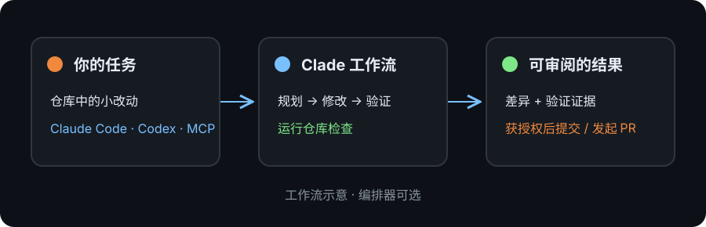

[English](README.md) | **中文**

# Clade

**把 coding agent 的工作变成可复查、可验证的交付。**

在你已经使用的 coding assistant 中，用 Clade 规划改动、运行项目检查、准备 commit 和 PR。
它为 Claude Code、Codex 添加工作流与 hooks，也能通过 MCP 接入其他客户端。
从一个任务开始即可，可选服务器不是前置条件。

[选择安装方式](#选择安装方式) · [试一个工作流](#第一次工作流) · [获取帮助](#社区与贡献)

> **实验阶段。** 先在可运行检查的仓库里尝试一个小任务。

<picture>
  <source media="(max-width: 600px)" srcset="assets/workflow-mobile.zh-CN.svg">
  
</picture>

*工作流示意。[图片范围与验证方式（英文）](docs/readme-media.md)。*

<details>
<summary>目录</summary>

- [选择安装方式](#选择安装方式)
- [安装](#安装)
- [第一次工作流](#第一次工作流)
- [Clade 能帮你什么](#clade-能帮你什么)
- [运行时边界](#运行时边界)
- [仓库结构](#仓库结构)
- [文档](#文档)
- [社区与贡献](#社区与贡献)
- [限制与许可证](#限制与许可证)

</details>

## 选择安装方式

| 你使用 | 从这里开始 | 安装内容 |
| --- | --- | --- |
| Claude Code | [完整框架](docs/getting-started.zh-CN.md#claude-code) | `~/.claude/` 下的 skills、hooks、agents、scripts 和安全指导 |
| Codex | [原生插件](docs/getting-started.zh-CN.md#codex) | 通过 Codex plugin marketplace 安装的原生 skills 和 hooks |
| Cursor、Windsurf、Claude Desktop 或其他 MCP 客户端 | [MCP bridge](docs/getting-started.zh-CN.md#mcp) | `clade-mcp`，调用你选择的 Claude 或 Codex CLI |
| 偏好图形化项目与任务操作，或需要证据 API 和 fleet 视图 | [可选 Orchestrator](docs/orchestrator.md) | 在本地浏览器中打开项目、安排任务和查看结果；原生入口可独立使用 |

## 安装

完整的前置条件、副作用、验证、更新和排障见[上手指南](docs/getting-started.zh-CN.md)。
最短路径如下：

### Claude Code

需要 Git、Bash、Python 3 和用于合并设置的 `jq`（推荐 Python 3.11）。在 clone 后的目录里运行：

```bash
git clone https://github.com/shenxingy/Clade.git clade
cd clade
./install.sh
```

安装后在你要处理的项目中打开新的 Claude Code 会话。安装器会把框架复制到用户配置目录；有 `jq` 时
会替换现有 hooks 和状态栏设置。先查看[安装影响](docs/getting-started.zh-CN.md#claude-code)。
它不会安装或共享 agent 凭证。

### Codex

需要支持 plugin 的 Codex CLI 和 Python 3（生成的 hooks 使用）。在 shell 中运行：

```text
codex plugin marketplace add shenxingy/Clade
codex plugin add clade@clade
```

新建 Codex thread，在 Codex 聊天中运行 `/hooks`，然后调用 `$clade:verify` 或
`$clade:review`。这些是聊天调用，不是 shell 命令。原生插件不需要 Claude Code。

### MCP

需要 Python 3.10+、`uv` 和客户端 `PATH` 中已登录的 Claude 或 Codex CLI。
将下面的 JSON 加入 MCP 客户端配置：

```json
{
  "mcpServers": {
    "clade": {
      "command": "uvx",
      "args": ["clade-mcp"],
      "env": { "CLADE_RUNTIME": "codex" }
    }
  }
}
```

此示例使用 Codex，默认 sandbox 为 `workspace-write`。
调用一次 `clade_list_skills`，确认列出的 skills 和 runtime。这个调用不会执行编码任务。
完整设置见 [MCP 指南](mcp-package/README.zh-CN.md)。若已有原生 Clade 入口，
不要重复挂载 MCP，以免重复加载和启动嵌套 agent。

## 第一次工作流

在一个有测试的小型、可回滚任务上试用。让 agent 先检查仓库并提出改动，然后审阅
变更文件并运行仓库自己的检查。

Claude Code 中可以在小改动后使用 `/verify`；Codex 使用 `$clade:verify`；MCP 则先用
`clade_list_skills` 发现对应工具，再调用 `clade_verify`。Clade 的证据和验证是审阅
材料，不代表自动获得 merge、push 或 publish 权限。

<details>
<summary>安装前，先试一次本地仓库检查</summary>

在 Clade 的 clone 中使用 Python 3 运行：

```bash
python3 configs/scripts/check-layers.py
```

成功时会输出 `check-layers: 6 layers declared and consistent` 及各层状态。
这是实际运行的仓库结构检查，不会调用 agent；它不验证登录凭证，也不代表已跑通编码工作流。
[检查范围与复现说明（英文）](docs/readme-media.md#local-check)。

</details>

## Clade 能帮你什么

| 你要做什么 | 使用 |
| --- | --- |
| 先理解一个新仓库 | `/map`、`/investigate` 或对应原生调用 |
| 运行仓库真实的本地 CI 闸门 | `/green` |
| 检查任务的行为锚点 | `/verify` |
| 保持工作隔离且易审阅 | `/worktree`、`/commit`、`/create-pr` |
| 审阅 PR 或安全边界 | `/review-pr`、`/cso`、`/incident` |
| 上下文用尽后继续 | `/handoff`，然后 `/pickup` |
| 研究陌生方案 | `/research` |

完整选择指南见 [When to Use What](docs/when-to-use-what.md)；hooks、agents、纠正学习
和交付边界见 [How It Works](docs/how-it-works.md)。

## 运行时边界

- Claude 框架是本地 shell 配置，会写入 home 目录并合并设置；应用前请检查 `install.sh`。
- Codex 插件是原生 Codex 入口，不会导入完整 Claude 安装，也不会复制凭证、模型或个人状态。
- MCP 根据 `CLADE_RUNTIME` 启动 agent CLI，以服务器启动时的目录作为项目目录。
  在客户端启动配置中指定目标仓库。Codex 默认使用 `workspace-write`；Claude runtime
  会跳过 CLI 权限提示。客户端审批不能为子进程提供 sandbox；见[运行时设置](docs/getting-started.zh-CN.md#mcp)。
- Orchestrator 是可选的次级控制平面；CLI 和原生插件不依赖它的 web UI 或数据库。

## 仓库结构

| 路径 | 职责 |
| --- | --- |
| [`configs/`](configs/) | skills、hooks、agents、脚本和跨项目规则的源文件 |
| [`plugins/clade/`](plugins/clade/) | Codex 原生插件；skills 从 `configs/` 生成 |
| [`mcp-package/`](mcp-package/) | 发布的 MCP bridge、runtime 选择和生成的 skill bundle |
| [`templates/`](templates/) | 仓库规则、README 与项目配置的起点 |
| [`docs/`](docs/) | 上手、架构、参考与贡献文档 |
| [`orchestrator/`](orchestrator/)、[`adapters/openclaw/`](adapters/openclaw/) | 可选、当前处于 dormant 状态的控制平面及适配器，见[分层状态](docs/layers.json) |

## 文档

| 指南 | 内容 |
| --- | --- |
| [上手指南](docs/getting-started.zh-CN.md) | 选择入口、第一次工作流、验证、更新与排障 |
| [Codex 原生支持](docs/codex.zh-CN.md) | 插件生命周期、hooks、迁移与更新恢复 |
| [MCP package](mcp-package/README.zh-CN.md) | runtime、客户端配置与 sandbox |
| [How It Works](docs/how-it-works.md) | hooks、agents、skills 与纠正学习 |
| [Configuration](docs/configuration.md) | 设置、阈值及自定义扩展 |
| [When to Use What](docs/when-to-use-what.md) | 工作流选择与 skill catalog |
| [Orchestrator](docs/orchestrator.md) | 可选 web 控制平面及独立启动方式 |
| [README 图片说明](docs/readme-media.md) | 示意图范围、参考方式与可复现的本地检查（英文） |
| [Changelog](CHANGELOG.zh-CN.md) | 版本历史与升级说明 |

## 社区与贡献

问题请发到 [Discussions](https://github.com/shenxingy/Clade/discussions)；可复现 bug 使用
[issue 表单](https://github.com/shenxingy/Clade/issues/new/choose)；安全漏洞请看[安全政策](SECURITY.md)。
文档、其他 shell 的测试、issue triage 和小范围 skills 都欢迎。请从
[CONTRIBUTING.md](CONTRIBUTING.md) 和 [good first issues](https://github.com/shenxingy/Clade/labels/good%20first%20issue) 开始。

## 限制与许可证

已知限制包括：非代码任务的 loop 可能没有 diff，worker 会继承父进程环境变量，长任务
需要用 `/handoff` 和 `/pickup` 管理上下文。请验证与你的仓库相关的行为；skill 数量或一次
成功的 hook 运行都不能证明完整交付。

Clade 使用 [MIT License](LICENSE)。依赖和 agent provider 仍受各自条款约束。
