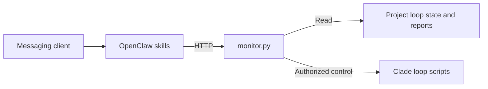

[English](README.md)

[Back to Clade](../../README.md)

# OpenClaw adapter

Inspect Clade loop status and session reports through an
[OpenClaw](https://openclaw.ai) messaging integration. The optional control tools
can also start or stop a loop. **This adapter is currently dormant**, as recorded
in [Clade's layer status](../../docs/layers.json); it is not part of the default
native Claude Code or Codex setup.

[Try the local health check](#try-the-local-monitor) ·
[Connect OpenClaw](#connect-openclaw) · [Get help](#help-and-directory-map)

## Contents

- [How it connects](#how-it-connects)
- [Try the local monitor](#try-the-local-monitor)
- [Connect OpenClaw](#connect-openclaw)
- [Available operations](#available-operations)
- [Access and side effects](#access-and-side-effects)
- [Help and directory map](#help-and-directory-map)

## How it connects



The monitor reads state files from configured projects. It does not require the
Orchestrator web server. This diagram describes the adapter's call path, not an
observed messaging session.

## Try the local monitor

Requires Python 3.10+ and `aiohttp`. Run from the Clade clone in a virtual environment:

```bash
python3 -m venv .venv-monitor
source .venv-monitor/bin/activate
python -m pip install aiohttp
python adapters/openclaw/monitor.py \
  --project /absolute/path/to/your/project --host 127.0.0.1 --port 9100
```

Replace the project path. In another terminal:

```bash
curl --fail http://127.0.0.1:9100/health
```

Expect JSON with `"ok": true` and a version. Stop the foreground server with
Ctrl-C. This checks local HTTP startup only; it does not send a message or run a
loop. Empty projects have no loop progress or session report to show.

## Connect OpenClaw

After the local check, configure authentication and your private connection
before connecting another client. Install the full Clade framework only if you
need loop-control commands; review its [installation effects](../../docs/getting-started.md#claude-code).
The monitor's `start` operation invokes the installed `~/.claude/scripts/start.sh`.

Copy the three skills from `skills/` into the OpenClaw skills directory used by
your installation. Configure `CLADE_BASE_URL` to the monitor's reachable URL and
`CLADE_API_KEY` to the same secret in both processes. Consult your OpenClaw
installation's configuration instructions; this repository does not provision
an account or messaging channel.

`monitor.service` is an optional systemd example. Inspect and replace its paths
and key settings before enabling it; it is not needed for the first local check.

## Available operations

| Operation | What it does |
| --- | --- |
| `GET /health` | Returns local server health; always unauthenticated |
| `GET /status?project=PATH` | Reads loop state, progress, commits, and cost information |
| `GET /report?project=PATH` | Reads saved reports, cost history, and blockers |
| `POST /control` with `start` | Writes a goal file and launches the installed Clade start script |
| `POST /control` with `stop` | Writes the loop's stop sentinel |
| `POST /control` with `clear-blockers` | Deletes that project's blocker file |

The OpenClaw skills are `clade-status`, `clade-report`, and `clade-control`.
Start with status and reports before authorizing control actions.

## Access and side effects

The program defaults to `0.0.0.0:9100`; an empty `CLADE_API_KEY` disables
authentication. The first-check command above explicitly binds localhost.
Set a key and use a private connection before exposing it to another machine.
All endpoints except health require `Authorization: Bearer <CLADE_API_KEY>`
when a key is configured.

Control operations can start an agent and change project files. There is no
general shell endpoint, but this is not a read-only service. Treat access to the
control endpoint as authority over the configured Clade loops.

## Help and directory map

| Path | Purpose |
| --- | --- |
| `monitor.py` | HTTP routes, state readers, and loop control |
| `skills/` | OpenClaw prompts for status, reports, and control |
| `monitor.service` | Optional service-manager example |

Use [Clade Discussions](https://github.com/shenxingy/Clade/discussions) for setup
questions and [Contributing](../../CONTRIBUTING.md) for reproducible bugs.
Include the adapter version and a synthetic project; do not post API keys,
private goals, or customer reports. End-to-end messaging behavior must be
verified in your own configured OpenClaw environment.
