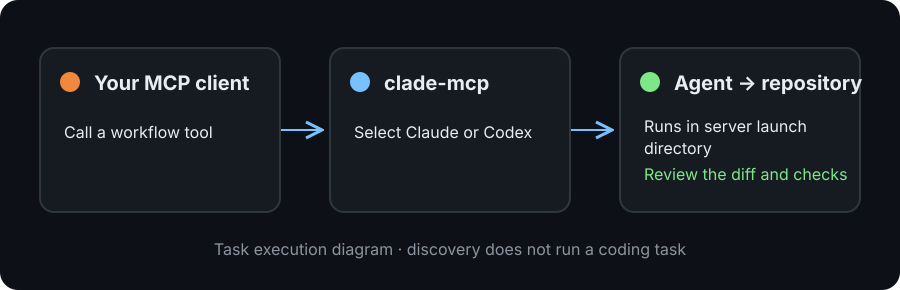

[English](README.md) | **中文**

# clade-mcp 0.3.1

**在你已有的 MCP 客户端中使用 Clade 工作流。** 连接 bridge，选择已登录的
Claude 或 Codex CLI，先发现工具，再执行任务。它在你的仓库中运行工作流 prompt，
不是托管 agent 服务。

[连接客户端](#快速开始) · [运行时边界](#runtime-配置) · [帮助与更新](#帮助与更新)

> **实验阶段。** 执行任务前，先确认所选 runtime 的权限边界。

<picture>
  <source media="(max-width: 600px)" srcset="https://raw.githubusercontent.com/shenxingy/Clade/a2bfe93879e95616905bdb882acb4ed4ea94bbca/assets/mcp-bridge-mobile.svg">
  
</picture>

*任务执行示意。调用 `clade_list_skills` 发现工具时不会运行编码任务。*

## 目录

- [快速开始](#快速开始)
- [Runtime 配置](#runtime-配置)
- [内置 Skills（36）](#内置-skills36)
- [工作机制](#工作机制)
- [完整 Clade 框架](#完整-clade-框架)
- [帮助与更新](#帮助与更新)
- [License](#license)


## 快速开始

下面的 JSON 写入 MCP 客户端配置，需要 `uv` 和已登录的 agent CLI 在客户端的
`PATH` 中。先把服务器启动工作目录设为目标仓库；服务器使用自己的当前目录，
不会协商客户端 workspace。首次连接后调用 `clade_list_skills` 查看选中的 runtime。

Claude runtime 会使用 `--dangerously-skip-permissions`，需要你自行提供隔离环境；
客户端审批不能为该子进程提供 sandbox。Codex 默认使用 `workspace-write`，下方的
Codex 配置显式选择此 runtime。默认值和 bypass 选项见[Runtime 配置](#runtime-配置)。

### Claude runtime

```json
{
  "mcpServers": {
    "clade": {
      "command": "uvx",
      "args": ["clade-mcp"]
    }
  }
}
```

### Codex runtime

```json
{
  "mcpServers": {
    "clade": {
      "command": "uvx",
      "args": ["clade-mcp"],
      "env": { "CLADE_RUNTIME": "codex" }
    }
  }
}
```

以上配置可用于 Claude Desktop、Cursor、Windsurf 或其他 MCP 客户端。
如果 Codex 已安装 Clade 原生 plugin，或 Claude Code 已安装 Clade 完整框架，
不要再挂载这个 MCP server；否则会重复加载 tools，并产生嵌套 agent session。

### 手动安装

```bash
python3 -m venv .venv
source .venv/bin/activate
python -m pip install --upgrade clade-mcp
clade-mcp  # 启动 stdio MCP server，等待客户端连接
```

## Runtime 配置

要求 Python 3.10+，并至少安装、登录一个受支持的 agent CLI。

| 环境变量 | 默认值 | 可选值与行为 |
|----------|--------|--------------|
| `CLADE_RUNTIME` | `claude` | `claude` 通过 `claude -p` 执行；`codex` 使用 `codex exec --json`；`auto` 优先 Claude，否则 Codex |
| `CLADE_CODEX_SANDBOX` | `workspace-write` | `read-only`、`workspace-write` 或 `danger-full-access` |
| `CLADE_CODEX_BYPASS_PERMISSIONS` | 未设置 | 仅在外部已经隔离的环境中设为 `1` |

**Codex 的** permission bypass 优先于 sandbox 设置，并向 Codex 传递
`--dangerously-bypass-approvals-and-sandbox`。这个 Codex 选项默认关闭；Claude runtime 的权限绕过行为见上文。

## 内置 Skills（36）

| Skill | 功能 |
|-------|------|
| **commit** | 按模块拆分改动做检查点提交;推送需另行授权 |
| **compute** | 大规模 CPU/GPU 任务的本地盘暂存、profiling、调度限流和恢复验证 |
| **create-pr** | 发布或更新一个绑定精确 SHA 的 pull request |
| **delivery** | 执行 checkpoint、审查、集成与清理的完整交付流程 |
| **loop** | 目标驱动的自主改进循环 |
| **review** | 基于 VERIFY.md 的覆盖式项目 review |
| **review-pr** | 对 PR diff 做结构化代码审查 |
| **investigate** | 根因分析；假设未确认不修复 |
| **incident** | 事故诊断、复盘与后续任务 |
| **cso** | OWASP + STRIDE 安全审计 |
| **map** | 生成带 Mermaid 图的 ARCHITECTURE.md |
| **research** | 深度网络调研并综合结论 |
| **batch-tasks** | 通过无人值守 session 执行 TODO |
| **handoff** | 保存 agent 交接状态 |
| **pickup** | 从 handoff 恢复工作 |
| **start** | 自主 session 启动器 |
| **verify** | 验证项目行为锚点、编译、测试与 lint |
| **sync** | 同步 TODO.md 与 PROGRESS.md |
| **document-release** | 发布后同步文档 |
| **brief** | 早晨简报：过夜活动、成本、下一步 |
| **retro** | 基于 git 历史的工程复盘 |
| **next** | 给出下一步建议；支持 deep 多轮模式 |
| **orchestrate** | 把目标拆成 worker tasks |
| **frontend-design** | 创建生产级前端界面 |
| **audit** | 清理、提升和去重纠正规则 |
| **merge-pr** | 按仓库规则合并精确审阅的 PR，再清理分支 |
| **worktree** | 创建并行 session 使用的 git worktrees |
| **pipeline** | 检查后台 pipelines 健康状态 |
| **provider** | 切换 LLM provider |
| **slt** | 切换 statusline 显示模式 |
| **model-research** | 调研最新 Claude models |
| **minimax-usage** | 检查 API 使用配额 |
| **poke** | 按 esc 后的三行进度心跳 |
| **status** | 显示 agents、loops、worktrees 和未推送 commits |
| **go** | 执行最近一次 A/B/C 选项中的推荐项 |
| **tasks** | 共享 Beads 任务规划、绑定、session、快照与受保护交接 |

## 工作机制

1. Server 启动时加载所有内置 skill definitions
2. 每个 skill 注册为带自动生成 JSON Schema 的 MCP tool
3. Tool 被调用时，selected runtime 在当前项目目录执行 skill prompt
4. 执行结果通过 MCP protocol 返回客户端

如果存在由旧版完整框架安装的 `~/.claude/skills/`，server 也会加载并合并；
同名时内置版本优先。

## 完整 Clade 框架

MCP server 只是 Clade 的一个入口。完整框架还包含：

- **138 个 skills**
- **35 个 hooks**
- **42 个 shell scripts + 31 个 Python utilities**
- **37 个专业 agents**
- 带 30 个核心 workflows、usage visibility 与安全 hooks 的 Codex 原生 plugin
- FastAPI orchestrator、task queue、worker pool 与 GitHub sync

```bash
git clone https://github.com/shenxingy/clade.git
cd clade && ./install.sh
```

## 帮助与更新

遇到配置问题，请在 [Clade Discussions](https://github.com/shenxingy/Clade/discussions)
提供 runtime、客户端、工作目录及错误信息，不要附带凭证或私有源码。
先调用 `clade_list_skills`；应能看到 catalog 和所选 runtime，再尝试执行工作流。

手动安装在原虚拟环境中使用 `python -m pip install --upgrade clade-mcp` 更新。
版本详情见[更新日志](https://github.com/shenxingy/Clade/blob/main/CHANGELOG.zh-CN.md)。
源码入口为 `src/clade_mcp/server.py`（工具）、`src/clade_mcp/runtime.py`（agent 执行）
和 `skills/`（生成的 prompt）。修改 prompt 时应编辑 Clade 的 `configs/skills/`，再生成 bundle。

## License

MIT

Release 与升级说明见[中文更新记录](../CHANGELOG.zh-CN.md)。
