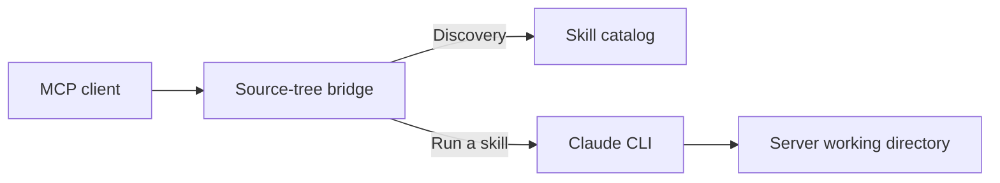

[English](README.md)

[Back to Clade](../README.md)

# Development MCP bridge

This directory holds client configuration for the **source-tree MCP server** in
`orchestrator/mcp_server.py`. For a new installation, use the
[published MCP package](../mcp-package/README.md), which supports explicit Claude
or Codex selection. Claude Code and Codex users with native Clade installed do
not need either bridge.

This source bridge executes skills through Claude. Its compact discovery surface
is useful when developing Clade's MCP integration; it is not the published
`clade-mcp` package.

## Contents

- [How requests flow](#how-requests-flow)
- [Connect from a source checkout](#connect-from-a-source-checkout)
- [First check](#first-check)
- [Compact mode](#compact-mode)
- [Boundaries and help](#boundaries-and-help)
- [Directory map](#directory-map)

## How requests flow



Discovery reads the catalog. Executing a skill launches an agent that can edit
files and commit changes; these are different operations.

## Connect from a source checkout

Requires Python 3.11, the Orchestrator dependencies, and an installed,
authenticated Claude CLI for skill execution. From the Clade clone:

```bash
python3.11 -m venv orchestrator/.venv
orchestrator/.venv/bin/python -m pip install -r orchestrator/requirements.txt
```

Use absolute paths to your clone in your client's configuration:

```json
{
  "mcpServers": {
    "clade-source": {
      "command": "/absolute/path/to/Clade/orchestrator/.venv/bin/python",
      "args": ["/absolute/path/to/Clade/orchestrator/mcp_server.py"]
    }
  }
}
```

Set the server's launch working directory in the client's launch settings to the
repository you intend to work on. Do not copy the machine-specific paths from an
existing local configuration. The JSON above is a template; replace both paths.

## First check

Connect the MCP client and call `clade_list_skills`. Expect a skill catalog before
attempting execution. Then use `clade_search_skills` to find a workflow. Listing
or searching does not establish authentication, a complete agent run, or the
correctness of a future change.

## Compact mode

`CLADE_MCP_COMPACT=1` is the default. It exposes `clade_list_skills`,
`clade_search_skills`, and `clade_run_skill`, plus code-search tools. Set
`CLADE_MCP_COMPACT=0` in the client's server environment only if you need one
advertised tool per skill. Per-skill names remain accepted in compact mode for
clients with cached tool lists.

## Boundaries and help

Skill execution uses `claude -p` with `--dangerously-skip-permissions`. The client
approval dialog is not a sandbox for that subprocess. Use an isolated project
and review the plan, changed files, and checks before authorizing delivery.

Keep this config outside the repository-root `.mcp.json`: automatically loading
it alongside native Clade duplicates tools and adds another agent process.
For normal setup, use [Getting started](../docs/getting-started.md#mcp).
Report reproducible integration bugs through [Contributing](../CONTRIBUTING.md)
without credentials or private source.

## Directory map

| Path | Purpose |
| --- | --- |
| `clade.mcp.json` | Local client-config example; replace its paths before use |
| [`orchestrator/mcp_server.py`](../orchestrator/mcp_server.py) | Source-tree tools and Claude subprocess execution |
| [`mcp-package/`](../mcp-package/) | Independently packaged bridge with Claude/Codex runtime selection |
| [`configs/skills/`](../configs/skills/) | Canonical workflow prompts |
